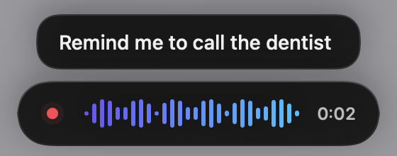
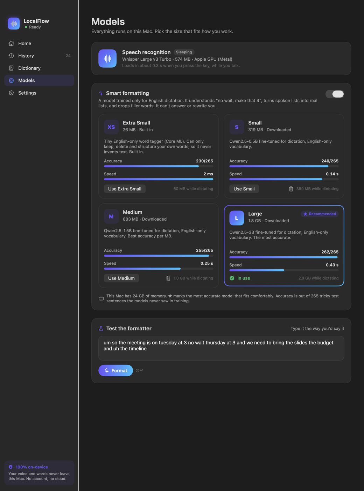

# LocalFlow

Private push-to-talk dictation for macOS that runs entirely on your Mac.

Hold a key, talk, let go. Your words are pasted into whatever app you're using. LocalFlow understands how
people actually talk: say *"book the room for Tuesday, no wait, Wednesday"* and it types
**Book the room for Wednesday.** Say *"shopping list, apples, rice, and dish soap"* and you get a real list.

No account, no cloud, no subscription. Audio and text never leave the Mac.

<p align="center"></p>

## Install

On an Apple Silicon Mac (M1 or newer) with macOS 14 or later, paste this into Terminal:

```sh
curl -fsSL https://raw.githubusercontent.com/Parker-LaBonte/localflow/main/install.sh | bash
```

That's the whole install. LocalFlow opens, downloads its models (0.6 GB for speech plus 0.3 to 1.8 GB for
formatting, depending on your Mac's memory), and walks you through two macOS permissions: Microphone and
Accessibility. Nothing else to install: no Homebrew, no Python, no Ollama.

Prefer to click? Download `LocalFlow.zip` from [Releases](../../releases/latest), unzip it, and drag
LocalFlow to Applications. The release is not notarized by Apple, so the first time, open
**System Settings → Privacy & Security** and click **Open Anyway**. (The Terminal install above skips this.)

## Use it

- **Hold Right Option** (or Fn / Right Command), talk, release. The text appears where your cursor is.
- **Tap** the key once for hands-free, tap again to finish. **Esc** cancels.
- Words show up above the recording pill while you talk.
- The menu bar icon has your recent dictations, the model picker and settings.
- **Dictionary:** add names and terms so they're always spelled your way ("github" → "GitHub").

## How it works

```
 hold key ─► mic (16 kHz) ─► whisper-server ─► cleanup + gate ─┬─► paste
                              Whisper Large v3 Turbo            │
                                                                └─► formatter ─► paste
                                                                    (only when the text has a correction or list cue)
```

- **Speech:** [whisper.cpp](https://github.com/ggml-org/whisper.cpp) running Whisper Large v3 Turbo on the GPU.
  8.2% word error rate on real recorded phone calls (Earnings-21).
- **Formatting:** small models fine-tuned only for this job, so they edit and never chat. A regex gate skips them for
  plain sentences, which are pasted instantly and never altered.

| Model | Download | Accuracy (265 test sentences) | Speed | Memory while dictating |
|---|---|---|---|---|
| Extra Small | built in | 230 | 2 ms | 60 MB |
| Small | 319 MB | 240 | 0.14 s | 0.4 GB |
| Medium | 883 MB | 255 | 0.25 s | 1.0 GB |
| Large | 1.8 GB | 262 | 0.43 s | 2.0 GB |

LocalFlow picks the most accurate model that fits comfortably in your Mac's memory; switch any time in **Models**.

<p align="center"></p>

### Memory

Nothing stays loaded while you aren't dictating. Both engines start when you press the key, so they
load (about 0.3 s) while you're still talking, and they unload 15 seconds after you finish. When idle,
LocalFlow is a ~65 MB menu bar app using no CPU. If you'd rather trade memory for instant starts, use
**Settings → Memory → Keep models loaded**.

### Privacy

- Speech and formatting run in local processes bound to `127.0.0.1`.
- The only network traffic is the one-time model download (Hugging Face for Whisper, this repo's releases
  for the formatters), each file checked against a SHA-256 hash.
- History, stats and your dictionary live in `~/Library/Application Support/LocalFlow`. You can turn history
  off or delete it in Settings.

## Build from source

```sh
brew install whisper-cpp llama.cpp     # their servers get bundled into the app
./build.sh                             # builds ~/Applications/LocalFlow.app and opens it
./build.sh --release                   # self-contained dist/LocalFlow.zip
```

Needs the Xcode command line tools. The app is plain Swift (SwiftUI + AppKit), built with `swiftc`, no Xcode project:

| File | What's in it |
|---|---|
| `Sources/Engine.swift` | Settings, the on-demand `whisper-server` / `llama-server` processes |
| `Sources/Text.swift` | Cleanup, the smart-format gate, dictionary, Extra Small tagger (Core ML) |
| `Sources/Models.swift` | Model catalog, tiers, verified downloads |
| `Sources/Audio.swift` | Microphone capture and pasting |
| `Sources/App.swift` | Hotkey, record → transcribe → format → paste, menu bar, windows |
| `Sources/Store.swift`, `Sources/UI.swift` | App state, history, stats, and the SwiftUI interface |
| `tools/bundle_engines.py` | Copies the engines and their libraries into the app |
| `train/` | Data, training recipes, test sets and evaluation for the formatting models ([details](train/README.md)) |

Handy for testing: `LocalFlow --selftest file.wav` (full pipeline on a 16 kHz WAV),
`LocalFlow --formattest "raw text"`, and `LocalFlow --snapshot <dir>` (renders every screen to PNGs).

## License

MIT for LocalFlow's code. Bundled engines and downloaded models keep their own licenses: see
[THIRD_PARTY_NOTICES.md](THIRD_PARTY_NOTICES.md). Note that the **Large** model inherits the
non-commercial Qwen Research License; Small and Medium are Apache 2.0.
